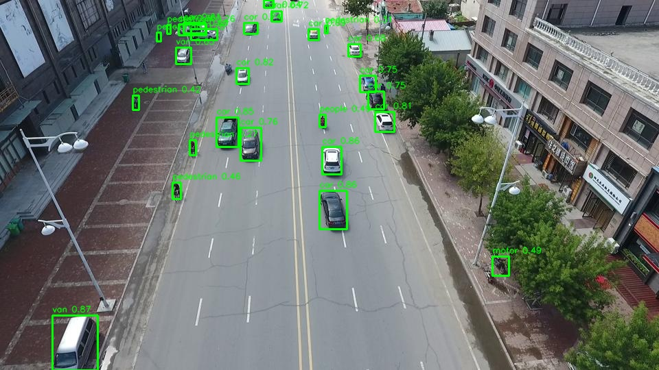
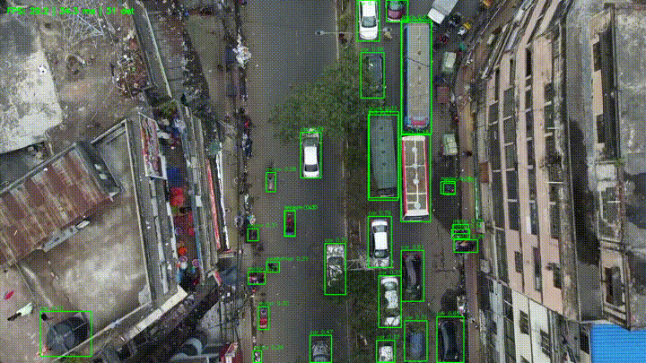

# Aerial Object Detection: YOLO11n on VisDrone → ONNX → C++ → Raspberry Pi

An end-to-end object detection pipeline for drone imagery. I fine-tuned YOLO11n on the VisDrone dataset, evaluated it with attention to small objects, exported it to ONNX, and reimplemented the full inference pipeline in C++ (OpenCV + ONNX Runtime). The C++ output matches the Python reference exactly. The target is a Raspberry Pi 4.

The goal is to understand the full path from training a model to running it efficiently on edge hardware. Every stage is checked numerically against the stage before it.


*C++ pipeline, 640 model: 26 detections, identical to the Python/Ultralytics reference.*


*Video mode, 416 model, with a live FPS / latency / detection-count overlay.*

---

## Project status

| Step | Description | Status |
|---|---|---|
| 1 | Baseline: pretrained YOLO11n (COCO) on VisDrone images | ✅ Done |
| 2 | Fine-tune on VisDrone (500-image subset, then full train set) | ✅ Done |
| 3 | Evaluation: precision / recall / mAP, recall by object size, failure cases | ✅ Done |
| 4 | Export to ONNX, inference in Python with ONNX Runtime, verify against Ultralytics | ✅ Done |
| 5 | C++ inference pipeline (OpenCV + ONNX Runtime + CMake), verified and benchmarked against Python | ✅ Done |
| 6a | Video input with per-stage timing (640 / 416 / 320) | ✅ Done |
| 6b | Benchmarks on Raspberry Pi 4 (640 / 416 / 320) | ⏳ Next |

---

## Pipeline

```
VisDrone images
   │
   ▼
Letterbox resize (keep aspect ratio, pad with gray 114) → RGB → /255 → CHW float tensor
   │
   ▼
YOLO11n (ONNX)  →  output [1, 14, N]
                     4 box values (cx, cy, w, h) + 10 class scores
                     N candidates = 80² + 40² + 20² = 8400 at 640
                                    (3549 at 416, 2100 at 320; strides 8 / 16 / 32)
   │
   ▼
Score filter (≥ 0.25) → class-aware NMS (IoU 0.7) → undo letterbox → clip to image
   │
   ▼
Detections (box, class, confidence)
```

The ONNX models are exported with static input sizes (640, 416, 320) and **without** built-in NMS, so postprocessing is implemented by hand in both Python and C++. The C++ detector reads the input size and number of candidates from the model, so one binary runs all three models.

---

## Dataset

[VisDrone2019-DET](https://github.com/VisDrone/VisDrone-Dataset): drone-captured images of urban scenes, with many small and densely packed objects.

- 10 classes: `pedestrian, people, bicycle, car, van, truck, tricycle, awning-tricycle, bus, motor`
- I wrote my own converter from raw VisDrone annotations (`left, top, w, h, score, category, truncation, occlusion`) to YOLO format (`class cx cy w h`, normalized). It drops "ignored regions" (category 0), "others" (category 11) and rows with score 0.
- The conversion is checked with a per-file box count, a duplicate-image hash check, and visual inspection of random images.

---

## Results: accuracy

### Fine-tuning (validation set)

| Run | Images | Epochs | imgsz | mAP50 | mAP50-95 | Precision | Recall |
|---|---|---|---|---|---|---|---|
| Subset | 500 | — | 640 | 0.149 | 0.080 | — | — |
| **Full** | full train set | 50 | 640 | **0.291** | **0.165** | 0.421 | 0.321 |

Per-class AP50 varies a lot: **car 0.719**, while bicycle (0.067) and awning-tricycle (0.079) are the weakest classes.

### Recall by object size

Measured over the 38,759 validation objects, matched at IoU ≥ 0.5 and conf ≥ 0.25. Size buckets use the COCO thresholds (small < 32², medium 32²–96², large > 96² px).

| Size | Objects | Share | Found | Recall |
|---|---|---|---|---|
| Small | 26,586 | 69% | 7,373 | **28%** |
| Medium | 11,105 | 29% | 7,752 | 70% |
| Large | 1,068 | 3% | 930 | 87% |
| **All** | 38,759 | | 16,055 | **41%** |

**Main finding:** 85% of all missed objects are small. The model is usable on medium and large objects. Small objects, which make up most of VisDrone, are the main limitation at 640 px input. Experiments in step 1 showed that a higher input resolution (1280) finds more small objects, at a large compute cost. That trade-off matters on a Raspberry Pi.

> Note: this recall is weighted by object count, whereas Ultralytics reports recall averaged per class. That's why the two numbers differ.

### Failure cases

I studied the images with the lowest recall:

| Image | Recall | Observation |
|---|---|---|
| `0000276_05601_d_0000535` | 0% | Daylight scene with hard shadows |
| `0000291_00001_d_0000868` | 7.9% | Very dense, very small objects |
| `0000001_04527_d_0000008` | 12.2% | Small, distant objects |
| `0000242_06010_d_0000017` | 12.2% | Small, distant objects |

---

## Results: correctness across implementations

Each implementation is checked against the previous one on the same image (`0000242_02400_d_0000009.jpg`, 960×540).

**Python ONNX (my own NumPy pre/postprocessing) vs Ultralytics**

| Check | Result |
|---|---|
| Detections | 26 / 26 matched |
| Lowest / average IoU | 1.0 / 1.0 |
| Largest confidence difference | 0.0 |
| Sanity check: boxes shifted by 5 px | 17 / 26 matched, lowest IoU 0.51 (the check does catch errors) |

**C++ vs Python, stage by stage**

| Stage | Check | Result |
|---|---|---|
| Letterbox | scale, padding, pixel values (incl. RGB order) | identical; tensor checksum within 0.02 of 552,103 (≈ 4×10⁻⁸ relative) |
| Raw model output | shape, top class score, candidates ≥ 0.25, largest box value | [1, 14, 8400], 0.8668, 123, 645.76: identical |
| Postprocessing + NMS | number of detections, top-5 class / score / box | 26 detections, top 5 identical to 2 decimals |
| All input sizes | detections at 640 / 416 / 320 | 26 / 24 / 19: identical to Python |

---

## Results: speed

### C++ vs Python (same machine, same engine)

WSL2 Ubuntu 24.04, ONNX Runtime **1.31.0** in both languages, CPU only, default threading. Median of 50 timed runs after 3 warm-up runs; image loading and drawing are not timed. Times in ms.
<!-- Fill in: CPU model (lscpu | grep "Model name") and nproc -->

| Model | Lang | Pre | Inference | Post | Total | FPS |
|---|---|---|---|---|---|---|
| 640 | Python | 4.43 | 60.19 | 3.26 | 68.66 | 14.6 |
| 640 | C++ | **1.54** | 65.28 | **0.09** | **67.39** | **14.8** |
| 416 | Python | 1.37 | 23.25 | 2.36 | 27.56 | 36.3 |
| 416 | C++ | **0.68** | 23.75 | **0.05** | **24.48** | **40.9** |
| 320 | Python | 0.91 | 13.61 | 1.18 | 15.98 | 62.6 |
| 320 | C++ | **0.44** | 13.52 | **0.03** | **14.00** | **71.4** |

C++ 640 is the median of 5 benchmark runs. Inference at 640 varied between 59 and 71 ms from run to run on this laptop, so the 640 inference difference between languages is within measurement noise.

**Findings**
1. **Inference is the same in both languages.** Both call the same ONNX Runtime engine, and inference is 85–97% of the total time.
2. **C++ makes preprocessing 2–3× faster and postprocessing 25–35× faster**, giving about **11–12% higher total throughput** at 416 and 320.
3. **Input size matters far more than language:** going from 640 to 320 is **~4.8× faster** (14.8 → 71.4 FPS), while C++ vs Python is ~1.1×. On edge hardware, the choice of model and input size decides the speed, and C++ adds the last 10–15% plus control over memory and latency.

### Optimization: preprocessing at 640

The first C++ version took **10.3 ms** to preprocess at 640, while 416 took 1.6 ms. That's 6.5× slower for 2.4× more pixels. The cause:
- **four temporary buffers allocated on every call** (about 12 MB at 640), and
- an HWC→CHW loop that **read the whole float image three times**, once per channel. At 640 the ~10 MB working set no longer fits in the CPU cache.

The fix: reuse class-member buffers that are allocated once, and do BGR→RGB, /255 and HWC→CHW in **one pass** directly from the uint8 image with row pointers.

| Model | Preprocess before | After | Speedup |
|---|---|---|---|
| 640 | 10.27 ms | 1.45 ms | **7.1×** |
| 416 | 1.57 ms | 0.75 ms | 2.1× |
| 320 | 0.98 ms | 0.61 ms | 1.6× |

The detections stayed identical before and after the change.

### Video: per-frame timing (C++)

A 2,859-frame aerial traffic video (~47 s, 60 fps), processed frame by frame: read → detect → draw → write. Each stage is timed per frame, and the first frames are excluded as warm-up. WSL2, Release build. Times in ms.

| Input | Detect median | Detect P95 | Detector FPS | Write (encode) | End-to-end median | End-to-end FPS | Write share of end-to-end |
|---|---|---|---|---|---|---|---|
| 640 | 73.1 | 93.8 | **13.7** | 15.4 | 93.8 | **10.7** | 16% |
| 416 | 28.0 | 38.3 | **35.7** | 15.3 | 48.0 | **20.8** | 32% |
| 320 | 18.2 | 34.4 | **54.8** | 15.9 | 38.7 | **25.9** | 41% |

Read (decode) is ~3 ms and drawing ~1 ms per frame for all three models.

**Findings**
1. **Video I/O is a fixed cost that becomes the bottleneck.** Read, draw and write take ~20 ms per frame regardless of model. Going from 640 to 320 makes the detector **4× faster** (13.7 → 54.8 FPS) but end-to-end only **2.4× faster** (10.7 → 25.9 FPS). At 320, more time goes to video I/O than to detection (Amdahl's law). On a drone, annotated video would normally not be encoded on board, so **detector FPS is the relevant system number**.
2. **The median is not enough for real time.** At a 30 fps camera (33 ms budget), 416 and 320 meet the budget at the median but not at P95, so about 1 in 20 frames is late. 640 misses it entirely.
3. **Jitter hurts small models the most.** P95/median for detection is 1.3× at 640 but 1.9× at 320. Scheduling noise on a shared laptop is roughly constant in milliseconds, so it weighs more when the model is fast.

**Observed model behavior on this video**
- Cars are detected reliably, with high confidence.
- Long buses are often labeled `truck`. The footage shows South Asian traffic, whose buses look different from the VisDrone (China) training data. This is **domain shift**.
- Dense clusters of motorbikes and pedestrians are largely missed, consistent with the small-object recall measured in step 3.
- Detections flicker between frames, as expected for per-frame detection without tracking.

---

## Repository structure

```
.
├── cpp/
│   ├── CMakeLists.txt
│   └── src/
│       ├── detector.hpp        # Detection / Timings structs, Detector class
│       ├── detector.cpp        # letterbox, ONNX Runtime inference, decode, NMS
│       └── main.cpp            # CLI: single image (draw + save), --bench mode, --video mode
├── python/
│   ├── onnx_infer.py           # preprocess / infer / postprocess / NMS in NumPy
│   ├── verify_against_ultralytics.py
│   └── benchmark.py            # timing at 640 / 416 / 320
├── models/                     # visdrone_yolo11n_{640,416,320}.onnx
├── image/                      # test images
├── docs/                       # images and GIF used in this README
├── videos/                     # input/output videos (not committed)
└── third_party/                # ONNX Runtime (not committed)
```

---

## Running it

### Python

```bash
python -m venv .venv && source .venv/bin/activate
pip install onnxruntime==1.31.0 opencv-python numpy ultralytics

python python/onnx_infer.py
python python/verify_against_ultralytics.py
python python/benchmark.py
```

### C++ (Ubuntu 24.04 / WSL2)

Requirements: gcc 13, CMake, pkg-config, `libopencv-dev`, and [ONNX Runtime 1.31.0](https://github.com/microsoft/onnxruntime/releases) (`onnxruntime-linux-x64-1.31.0`) unpacked into `third_party/`.

```bash
sudo apt install build-essential cmake pkg-config libopencv-dev

cmake -S cpp -B cpp/build-release -DCMAKE_BUILD_TYPE=Release
cmake --build cpp/build-release

# Detect, draw and save
./cpp/build-release/visdrone_app models/visdrone_yolo11n_640.onnx \
    image/0000242_02400_d_0000009.jpg output_640.jpg [conf]

# Benchmark: 3 warm-up runs + N timed runs, prints medians per stage
./cpp/build-release/visdrone_app models/visdrone_yolo11n_640.onnx \
    image/0000242_02400_d_0000009.jpg output_640.jpg --bench 50

# Video: annotated output + per-stage timing (median / P95 / max)
./cpp/build-release/visdrone_app models/visdrone_yolo11n_416.onnx \
    --video videos/input.mp4 videos/output_416_timed.mp4
```

The ONNX Runtime library path is embedded in the binary through RPATH, so `LD_LIBRARY_PATH` isn't needed.

---

## Tools

Python · Ultralytics YOLO11 (8.4) · PyTorch · Google Colab (T4) · ONNX · ONNX Runtime 1.31 · NumPy · OpenCV · C++17 · CMake · WSL2 · Raspberry Pi 4 (target)

## Next steps

- **Raspberry Pi 4 (64-bit OS):** C++ and Python benchmarks (image and video) at 640 / 416 / 320, to find the input size that runs in real time
- **Accuracy vs input size:** mAP and small-object recall at 416 and 320, for a full speed-vs-accuracy trade-off table
- **Pipelined video loop:** separate threads for capture, detection and writing (bounded queue), so end-to-end throughput approaches detector throughput; for a live camera, always process the newest frame
- **Tracking:** a simple tracker (e.g. ByteTrack/SORT) to stabilize detections across frames
- **Faster inference:** INT8 quantization, explicit thread settings
- **Better small-object recall:** higher input resolution, tiling/slicing (SAHI), or a P2 detection head

## Author

Justus Anoruo · [github.com/justusa11](https://github.com/justusa11)